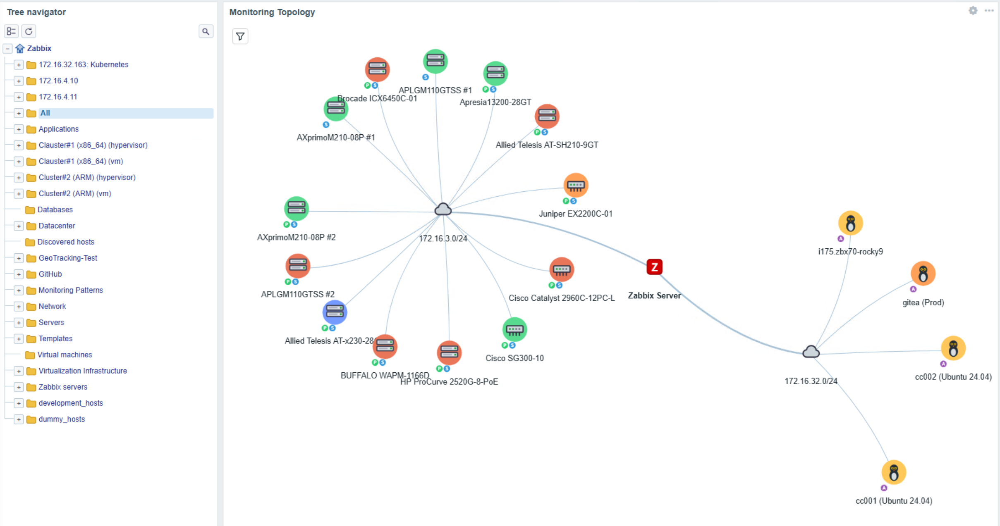
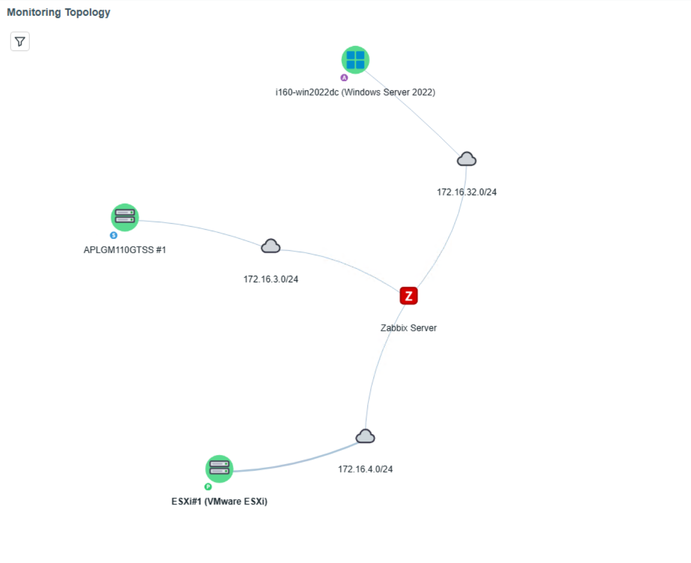
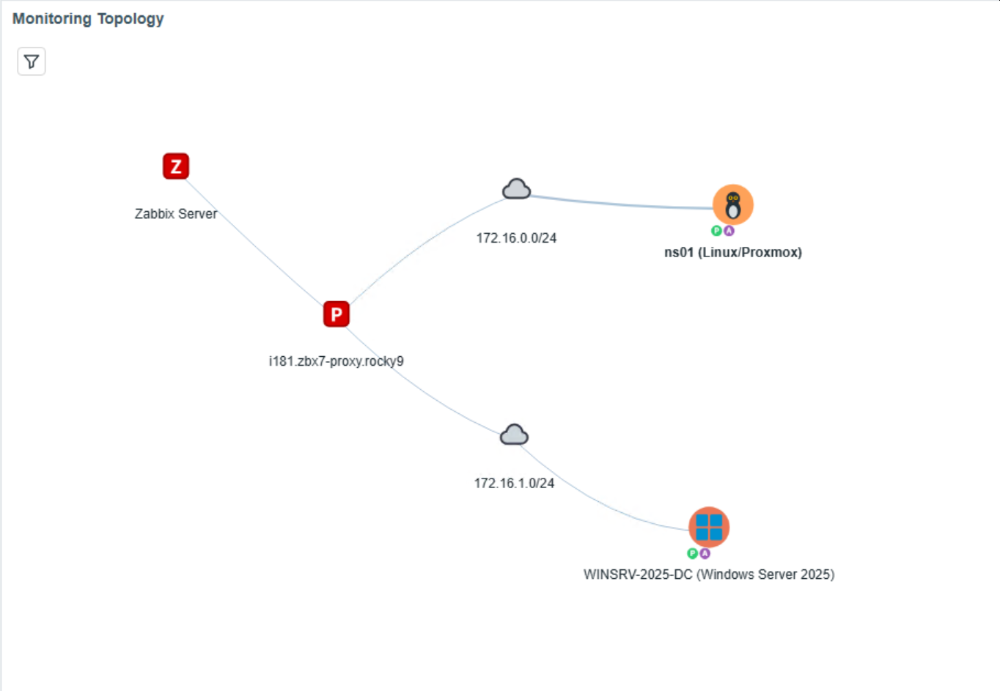
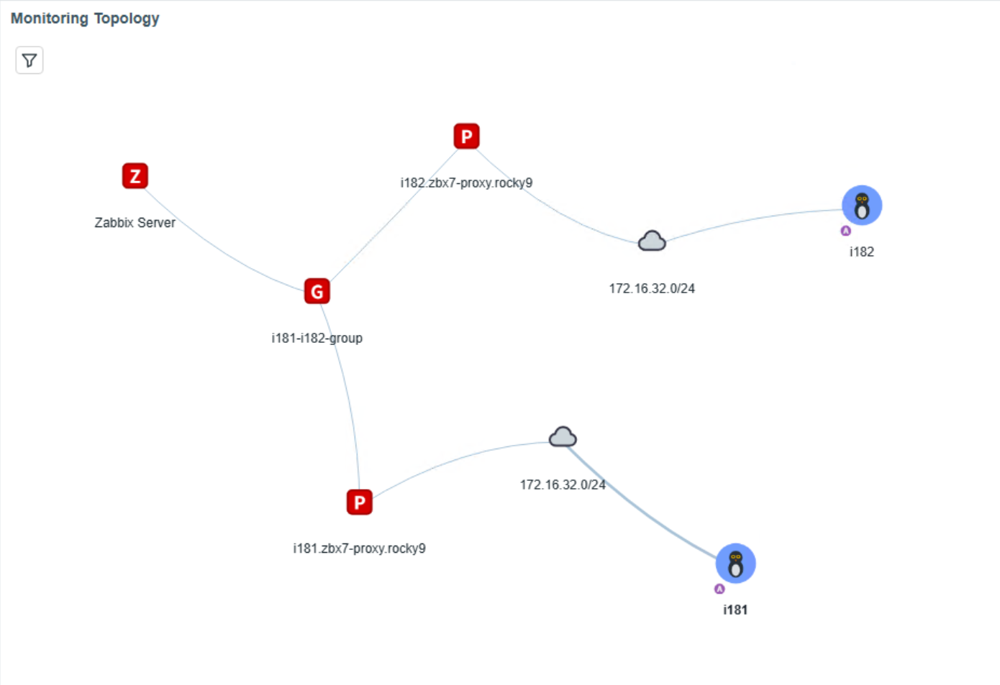
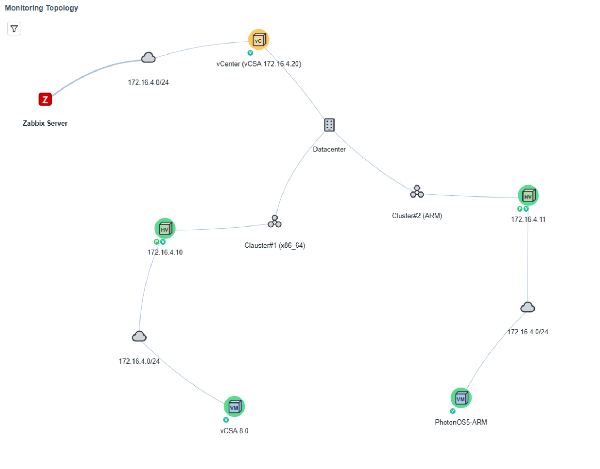
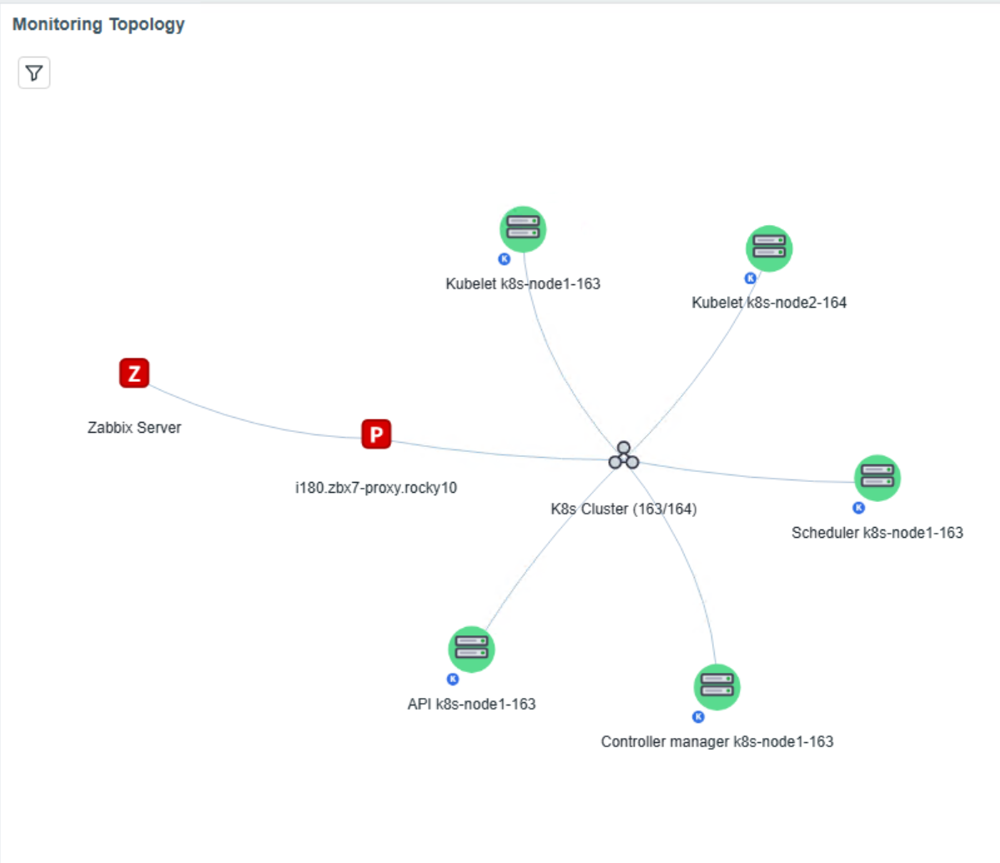
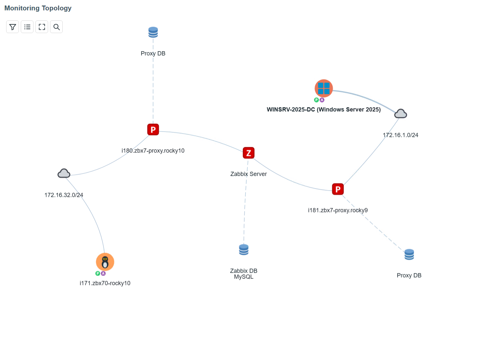
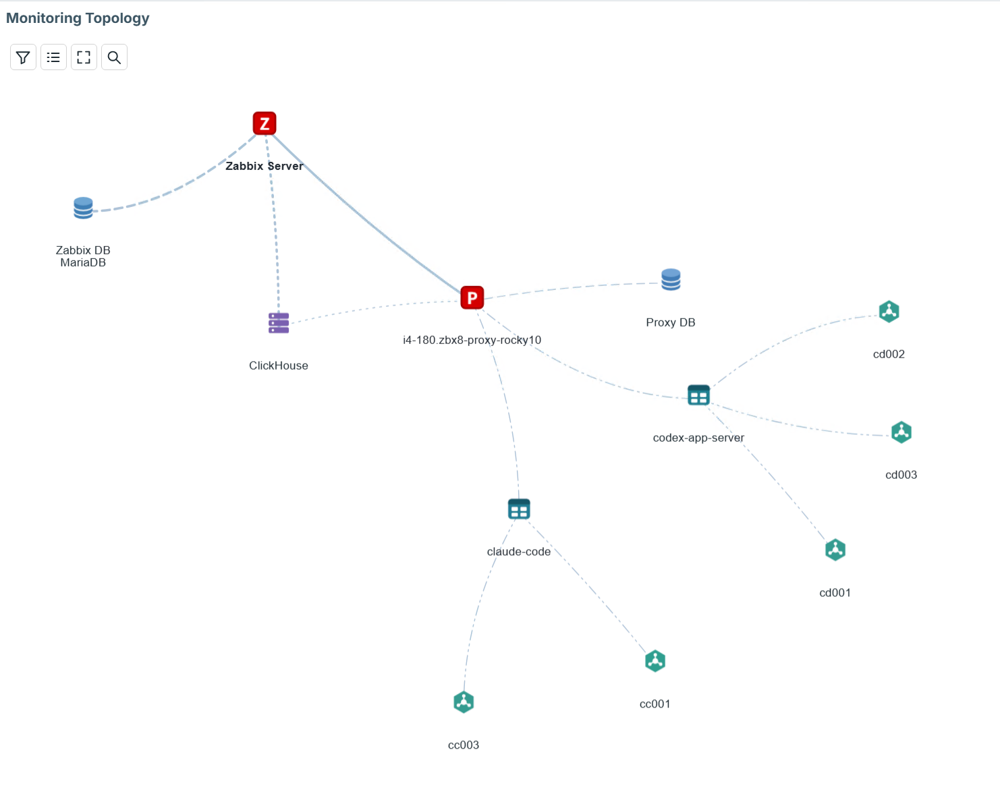
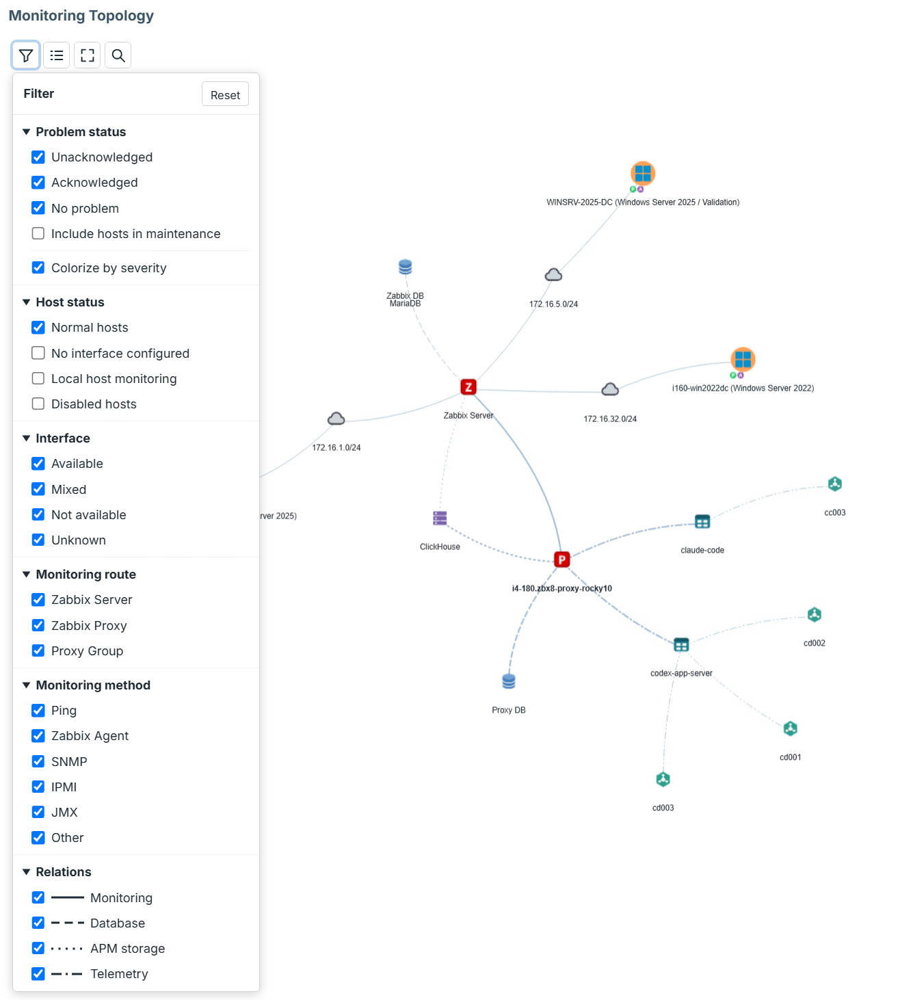
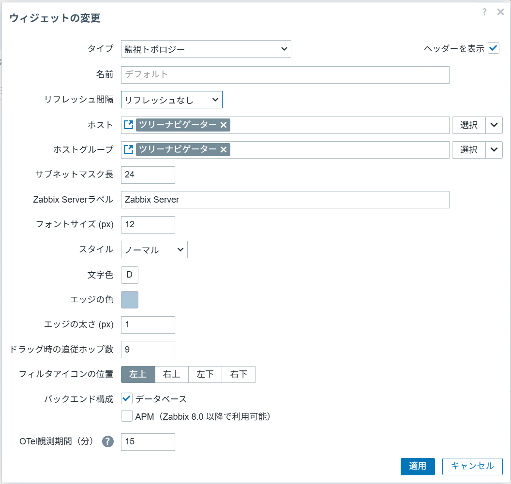

# zabbix-widget-monitoring-topology

[English](README.md) | 日本語

## 概要

Monitoring Topology は、Zabbix が監視しているホストへ至る監視経路をトポロジーとして可視化するダッシュボードウィジェットです。

固定指定した複数のホストグループ、またはナビゲータ等から受信したホスト／ホストグループを描画対象にできます。Server・Proxy・Proxy Groupの監視経路、並びにVMware仮想化とKubernetesクラスタの階層を可視化します。Zabbix 8.0では、APM監視で保存されたOpenTelemetryトレース（Span）の収集経路も表示できます。

グラフ描画には Vis Network の Canvas2D を使用しています。（WebGL は不要）

<a href="screenshots/monitoring-topology-dashboard-example.png" target="_blank"></a>

[最新リリース](https://github.com/HOLOZTEK/zabbix-widget-monitoring-topology/releases/tag/v1.2.7) | [RPM](https://github.com/HOLOZTEK/zabbix-widget-monitoring-topology/releases/download/v1.2.7/zabbix-widget-monitoring-topology-1.2.7.noarch.rpm) | [DEB](https://github.com/HOLOZTEK/zabbix-widget-monitoring-topology/releases/download/v1.2.7/zabbix-widget-monitoring-topology_1.2.7_all.deb) | [Source（tar.gz）](https://github.com/HOLOZTEK/zabbix-widget-monitoring-topology/releases/download/v1.2.7/zabbix-widget-monitoring-topology-1.2.7.tar.gz) | [Source（zip）](https://github.com/HOLOZTEK/zabbix-widget-monitoring-topology/releases/download/v1.2.7/zabbix-widget-monitoring-topology-1.2.7.zip)

## Monitoring Topology を使う理由

通常のダッシュボードではホスト状態を確認できますが、各ホストがどの Server／Proxy から監視されているかを一覧で把握することは容易ではありません。本ウィジェットは、Zabbix の設定・アイテム・ディスカバリ関係を基に監視経路をトポロジーとして描画することで、監視網全体を可視化すると同時に、監視経路の親子関係の把握を助けます。

監視対象のホスト数が多い環境または高度な分散監視を行う環境において、Server／Proxy とホストの対応、サブネット別の配置、VMware や Kubernetes の親子関係を運用者が俯瞰したい場合に適しています。

## 機能

<table>
  <tr><th align="left" nowrap>機能</th><th align="left">説明</th></tr>
  <tr><td nowrap>監視経路グラフ</td><td>Zabbix Server、Zabbix Proxy、Proxy Group、Network、Host を接続して表示します。</td></tr>
  <tr><td nowrap>ネットワーク表示</td><td>ホストのインターフェースIPと設定可能なIPv4プレフィックス長からNetworkノードを算出します。監視経路の描画を優先しているため、同一のネットワークが異なる経路で接続される場合には、同一のネットワークセグメントが複数ヶ所に描画される場合があります。</td></tr>
  <tr><td nowrap>VMware監視</td><td>公式VMwareテンプレートのディスカバリとアイテムから Datacenter → Cluster → ESXi Host の階層を構成し、VMをESXi Host配下のNetworkノード経由で表示します。</td></tr>
  <tr><td nowrap>Kubernetes監視</td><td>公式Kubernetesテンプレートのキーとディスカバリ関係を検出し、Network → 集約ホスト → Kubernetes Cluster → 構成要素ホストの階層を表示します。</td></tr>
  <tr><td nowrap>インターフェイスなしホスト</td><td>インターフェースを持たない監視ホストでは、接続先マクロからネットワークまたはラベルを判定して表示します。</td></tr>
  <tr><td nowrap>機器・監視方式表示</td><td>ホスト種別アイコンに対して、監視方式のバッジ（Ping、SNMP、Agent、IPMI、VMware、ODBC、JMX、Kubernetes 等）を表示します。</td></tr>
  <tr><td nowrap>障害状態の表示</td><td>ホストで検知されている障害の深刻度の色をアイコンの背景に表示します。複数の障害が発生している場合は、深刻度が最も高い障害の色が選択されます。</td></tr>
  <tr><td nowrap>表示フィルタ</td><td>ホスト、バックエンド構成要素、関係の線を絞り込みます。「フィルター」設定タブで初期状態を指定できます。</td></tr>
  <tr><td nowrap>描画対象の指定</td><td>複数のホストグループを固定指定するほか、ナビゲータからホスト／ホストグループを受信して動的に描画内容を変更できます。</td></tr>
  <tr><td nowrap>バックエンド構成</td><td>Zabbix DBとProxy DBを任意で表示します。</td></tr>
  <tr><td nowrap>APM監視</td><td>APM監視で保存されたOpenTelemetryトレースの収集経路を任意で表示します。</td></tr>
  <tr><td nowrap>表示状態の維持と操作ツール</td><td>リフレッシュ時のノード位置を維持し、検索、全体表示、情報パネル、ドラッグ時の追従ホップ数、配置計算の表示設定を提供します。</td></tr>
  <tr><td nowrap>対話操作</td><td>ノードの移動とレイアウトの調整、ホストのメニューへのアクセスに対応します。</td></tr>
</table>

## トポロジーモデル

Monitoring Topology は、Zabbix Serverからの直接監視、Zabbix Proxy経由の分散監視、インターフェース情報、ディスカバリ関係、ホストマクロ、監視アイテムからトポロジーを構成します。実際の構造はZabbixで取得できるデータに依存します。

障害の深刻度はホストに対してのみ表示を行い、Server、Proxy、Proxy Group、ネットワーク、クラスタなどのグループに対しては表示しません。

描画が対応している主なモデルパターンは次のとおりです。

<table>
  <tr><th align="left" nowrap>パターン</th><th align="left">判定方法（代表的な経路を含む）</th><th align="left">参考画像</th></tr>
  <tr><td nowrap>ZabbixServer経由</td><td><strong>代表的な経路:</strong> <code>Zabbix Server -&gt; Network -&gt; Host</code><br>Zabbix Serverがホストを直接監視します。プライマリインターフェースと設定されたサブネットプレフィックスからNetworkノードを決定します。</td><td><a href="screenshots/monitoring-topology-zabbix-server.png" target="_blank"></a></td></tr>
  <tr><td nowrap>ZabbixProxy経由</td><td><strong>代表的な経路:</strong> <code>Zabbix Server -&gt; Zabbix Proxy -&gt; Network -&gt; Host</code><br>単体のZabbix Proxyが割り当てられたホストを、そのProxyと算出したNetworkノードの配下に配置します。</td><td><a href="screenshots/monitoring-topology-zabbix-proxy.png" target="_blank"></a></td></tr>
  <tr><td nowrap>Proxy Group経由</td><td><strong>代表的な経路:</strong> <code>Zabbix Server -&gt; Proxy Group -&gt; Zabbix Proxy -&gt; Network -&gt; Host</code><br>Proxy Group経由で監視するホストを、グループと監視経路に使われるメンバーProxyの配下に配置します。</td><td><a href="screenshots/monitoring-topology-proxy-group.png" target="_blank"></a></td></tr>
  <tr><td nowrap>VMware監視</td><td><strong>代表的な経路:</strong> <code>Server/Proxy -&gt; Network -&gt; VMware監視ホスト（Zabbix Host） -&gt; Datacenter -&gt; Cluster -&gt; ESXi Host -&gt; Network -&gt; VM</code><br>公式VMwareテンプレートのディスカバリと <code>vmware.hv.*</code> アイテムから、VMware監視ホストとインベントリ階層を構成します。VMは所属するvCenterとESXi Hostを識別し、ゲストのIPアドレスから算出したNetworkノードの配下へ配置します。</td><td><a href="screenshots/monitoring-topology-vmware.png" target="_blank"></a></td></tr>
  <tr><td nowrap>Kubernetes監視</td><td><strong>代表的な経路:</strong> <code>Server/Proxy -&gt; Network -&gt; 集約ホスト（Zabbix Host） -&gt; Kubernetes Cluster -&gt; Kubernetes構成要素ホスト（Zabbix Host）</code><br>公式Kubernetesテンプレートのアイテムキーとディスカバリ親からクラスタを識別します。集約ホストをクラスタの親として自動取得し、API Server、Scheduler、Controller Manager、Kubeletなどの構成要素ホストをロール別に配置します。同じ経路上の複数クラスタも分離します。</td><td><a href="screenshots/monitoring-topology-kubernetes.png" target="_blank"></a></td></tr>
</table>

### ドラッグ時の追従ホップ数

ノードをドラッグするときに、接続関係を何段階先までレイアウト調整へ追従させるかを0〜10ホップで指定します。既定値は6です。ドラッグしたノードから指定ホップ数以内にあるノードだけが一時的に物理レイアウトの対象となり、その範囲外のノードは位置を維持します。

0を指定した場合はドラッグしたノードだけを移動します。過去に手動配置したノードは追従対象から除外され、配置した位置を維持します。ドラッグ終了後は周辺レイアウトが整った時点で物理演算を停止し、調整後の位置を維持します。

通常のリフレッシュでは、拡大率、表示位置、ノード位置、Proxyのハイライトを維持します。ナビゲータ等から受信するホスト／ホストグループが変わった場合は新しいトポロジーとして全体を再配置し、表示範囲を合わせます。同じ選択内容が異なる順序で再送された場合は再配置しません。

### 表示前の配置計算回数

新しいレイアウトをどの段階から表示するかを0〜1000で指定します。既定値は0です。0では配置計算が安定してからトポロジーを表示します。1以上では指定回数を計算した時点で表示し、安定するか20秒が経過するまでノードが広がる動きを表示します。初回表示、描画対象の変更、構成が大きく変わった場合に適用し、通常のリフレッシュでは既存の配置を維持します。

## バックエンド構成

バックエンド構成は任意で、既定では無効です。Zabbix ServerとZabbix Proxyが使用するデータベースを論理的なバックエンドとして表示します。

- `Zabbix Server → Zabbix DB`
- `Zabbix Proxy → Proxy DB`

Zabbix ServerのDB種別は、最初にServerの実行時DBバージョン情報から判定します。MySQL、MariaDB、PostgreSQLのいずれかを確認できた場合は、その種別を確定情報として表示します。実行時情報から判定できない場合は、Zabbixフロントエンドの接続設定を補助情報として参照し、MySQLまたはPostgreSQLを推定情報として表示します。どちらからも判定できない場合は、種別を付けずに「Zabbix DB」と表示します。

Zabbix ProxyのDB種別はZabbix APIから取得できないため推測せず、種別を付けずに「Proxy DB」と表示します。DBノードのツールチップでは、種別を取得できた場合に判定元も表示します。

<a href="screenshots/monitoring-topology-backend-database.png" target="_blank"></a>

## APM監視

APM監視のトポロジー表示は任意で、既定では無効です。Zabbix 8.0以降のAPM監視で保存されたOpenTelemetryトレースから、次の論理的な表示構造を構成します。

`Zabbix Server → APM Data Store → APM有効Zabbix Proxy → OpenTelemetryサービス（service.name）→ OpenTelemetryシステム（host.name）`

これはTelemetryの通信方向を示すものではありません。実際のトレースは、OpenTelemetry送信元からZabbix Proxy／APM Collectorを経由してAPM Data Storeへ保存されます。

APM Data Storeは、グローバルAPMデータソースを参照できる場合はClickHouseとして表示し、それ以外は汎用名で表示します。APM Data StoreとProxyの関係は、APM Collectorが有効なProxyとグローバルAPMデータソースの関係を示すもので、Proxyごとの実際の書き込み先を保証するものではありません。

OpenTelemetryノードを表示するには、Monitoring Topologyの描画対象として少なくとも1台のZabbix Hostと、使用するOS向けのAPM対応Proxy環境が必要です。選択したZabbix HostとOpenTelemetryシステムの<code>host.name</code>が一致する必要はありません。Zabbix 8.0のAPM対応Proxyパッケージが提供されていないEL9ではAPM/OpenTelemetry表示を利用できませんが、これはMonitoring Topology本体の対応OSを制限するものではありません。

<a href="screenshots/monitoring-topology-apm-opentelemetry.png" target="_blank"></a>

詳細な設定、権限制御、取得上限、制約、トラブルシュートは[APM監視 / OpenTelemetry Topology 導入・運用ガイド](docs/OTEL_TOPOLOGY_SETUP.ja.md)を参照してください。

## 表示フィルタ

フィルタパネルは、表示するHostノード、バックエンド構成要素、関係の線を絞り込みます。ホストに関する同じカテゴリ内の選択肢はOR、5つのホストカテゴリ間はANDで組み合わせます。表示対象の子孫Hostへ至る上位ノードとエッジは表示を維持し、経路が分断されないようにします。

<table>
        <tr><th align="left" nowrap>カテゴリ</th><th align="left">選択肢</th><th align="left">用途と既定状態</th></tr>
        <tr><td nowrap>障害状態</td><td>未確認、確認済み、障害なし、メンテナンス中を含む、深刻度で色分け表示</td><td>メンテナンス中でないHostを障害状態で絞り込みます。未確認、確認済み、障害なしは既定でONです。「メンテナンス中を含む」は独立した表示条件で既定OFF、「深刻度で色分け表示」は表示可否に影響しない色分け設定で既定ONです。</td></tr>
        <tr><td nowrap>ホスト状態</td><td>通常ホスト、インターフェイス設定なし、ローカルホスト監視、無効ホスト</td><td>設定・運用状態でHostを排他的に分類します。既定では通常ホストだけがONです。</td></tr>
        <tr><td nowrap>インターフェイス</td><td>正常、一部監視不可、監視不可、状況不明</td><td>インターフェースの可用性でHostを絞り込みます。既定ではすべてONです。</td></tr>
        <tr><td nowrap>監視経路</td><td>Zabbix Server、Zabbix Proxy、Proxy Group</td><td>上流の監視経路でHostを絞り込みます。既定ではすべてONです。</td></tr>
        <tr><td nowrap>監視方式</td><td>Ping、Zabbix Agent、SNMP、IPMI、JMX、その他</td><td>検出した監視方式でHostを絞り込みます。既定ではすべてONです。「その他」にはVMware、ODBC、Kubernetes、個別分類できない方式を含みます。</td></tr>
        <tr><td nowrap>構成要素</td><td>データベース、APMデータストア、OpenTelemetry</td><td>取得済みの構成要素ノードと接続する線を表示・非表示にします。非表示にしてもデータ取得は停止しません。</td></tr>
        <tr><td nowrap>関係</td><td>監視経路、データベース、APMストレージ、Telemetry</td><td>取得済みの関係の線だけを表示・非表示にし、ノードは残します。TelemetryはProxy—ServiceとService—Systemの線です。</td></tr>
</table>

<a href="screenshots/monitoring-topology-filters.png" target="_blank"></a>

ホストカテゴリ内の表示条件をすべてOFFにすると、すべてのHostが非表示になります。「深刻度で色分け表示」は表示可否には影響しません。「フィルター」設定タブが初期状態を定義します。ダッシュボード上で変更した状態は通常のリフレッシュ中は維持されますが、ブラウザには保存されません。ページの再読み込みまたは「リセット」で設定タブの値へ戻ります。フィルター操作ではデータを再取得せず、ノードも移動しません。取得していない構成要素と関係は、どちらのフィルターでも選択できません。

## 情報パネル

ツールバーの「情報」パネルでは、取得したトポロジーのノード数と関係数、データベース構成の状態、APM/OpenTelemetryの観測期間・取得件数・取得状態、凡例を確認できます。通常のリフレッシュに追従して更新され、追加のクエリは行いません。OpenTelemetryサービス／システムのツールチップには、ウィジェットが取得した最新Spanの時刻を利用者のZabbixタイムゾーンで「最終観測」として表示します。

## 設定項目

設定画面は4つのタブに分かれています。

<table>
  <tr><th align="left" nowrap>タブ</th><th align="left" nowrap>項目</th><th align="left">説明</th></tr>
  <tr><td nowrap>監視対象</td><td nowrap>ホスト</td><td>ナビゲータ等と接続する受信専用コネクタです。</td></tr>
  <tr><td nowrap>監視対象</td><td nowrap>ホストグループ</td><td>サブグループを含む複数のホストグループを固定指定するか、他ウィジェットから受信します。</td></tr>
  <tr><td nowrap>監視対象</td><td nowrap>サブネットプレフィックス長</td><td>Networkノード算出用のIPv4プレフィックス。既定値は24です。</td></tr>
  <tr><td nowrap>監視対象</td><td nowrap>Zabbix Serverラベル</td><td>ルートServerノードに表示する名称です。</td></tr>
  <tr><td nowrap>データ取得</td><td nowrap>バックエンド構成</td><td>データベース構成とAPM監視データを取得します。APMにはZabbix 8.0以降が必要です。</td></tr>
  <tr><td nowrap>データ取得</td><td nowrap>OTel観測期間（分）</td><td>対象Spanの期間を5〜1440分で指定します。既定値は15です。</td></tr>
  <tr><td nowrap>フィルター</td><td nowrap>初期フィルター状態</td><td>障害状態、ホスト状態、インターフェイス、監視経路、監視方式、構成要素、関係の初期値を指定します。</td></tr>
  <tr><td nowrap>外観</td><td nowrap>フォント・スタイル・エッジ</td><td>ノードラベルのフォント、エッジ色、エッジ幅を指定します。</td></tr>
  <tr><td nowrap>外観</td><td nowrap>ドラッグ時の追従ホップ数</td><td>追従する接続範囲を0〜10で指定します。既定値は6です。</td></tr>
  <tr><td nowrap>外観</td><td nowrap>表示前の配置計算回数</td><td>新しいレイアウトを表示するまでの計算回数を0〜1000で指定します。既定値は0です。</td></tr>
  <tr><td nowrap>外観</td><td nowrap>フィルタアイコンの位置</td><td>左上、右上、左下、右下から選択します。</td></tr>
</table>

<a href="screenshots/monitoring-topology-settings-ja.png" target="_blank"></a>

## 描画対象の指定とダッシュボード連携

設定画面でホストグループを複数固定指定すると、本ウィジェットを単独で使用できます。指定したグループのサブグループに属するホストも対象です。

動的に対象を変更する場合は、ホストまたはホストグループをナビゲータ等へ接続します。ホストは受信専用です。ホストグループは固定指定と他ウィジェットからの受信のどちらにも対応します。固定ホストグループと受信したホストを同時に指定した場合は、両方の和集合を表示します。固定対象も受信対象もない場合は空状態を表示します。

1. `_hostid` または `_hostgroupid` を配信するナビゲーターを配置します。
2. 同じページへ Monitoring Topology を追加します。
3. 必要に応じてリフレッシュ間隔を設定します。APMを有効にすると、リフレッシュ時にAPM Traceの取得が行われます。
4. 設定画面でホスト／ホストグループを送信元ウィジェットへ接続します。
5. ホスト選択時はそのホストの経路、ホストグループ選択時はグループ内ホストの経路を表示します。

## 動作要件

- Zabbix 7.0 または 8.0
- PHP 8.1 以上
- RPM パッケージ: RHEL 互換 9／10
- Zabbix フロントエンドがサポートするブラウザ

## インストール

### RPM

```bash
dnf install ./zabbix-widget-monitoring-topology-1.2.7.noarch.rpm
```

### DEB

```bash
apt install ./zabbix-widget-monitoring-topology_1.2.7_all.deb
```

パッケージは実行ファイルを利用中のZabbixフロントエンドモジュールディレクトリへ配置します。その後、管理 → モジュールで再スキャンして有効化し、ダッシュボードへ追加してください。

### ソースから

通常はRPMまたはDEBを推奨します。手動インストールには、Release Assetsへ添付されたHOLOZTEK公式Sourceパッケージを使用してください。`assets/js/vis-network.min.js`を含む実行時ファイルをすべて同梱しています。タグから自動生成される「Source code」アーカイブは使用しないでください。

配置先はZabbixのバージョンで異なります。

| Zabbix | モジュールディレクトリ |
|---|---|
| 8.0 | `/usr/share/zabbix/ui/modules/holoztek_monitoringmap/` |
| 7.0 | `/usr/share/zabbix/modules/holoztek_monitoringmap/` |

Zabbix 8.0の例:

```bash
curl -L -o zabbix-widget-monitoring-topology-1.2.7.tar.gz https://github.com/HOLOZTEK/zabbix-widget-monitoring-topology/releases/download/v1.2.7/zabbix-widget-monitoring-topology-1.2.7.tar.gz
tar -xzf zabbix-widget-monitoring-topology-1.2.7.tar.gz
sudo mkdir -p /usr/share/zabbix/ui/modules/holoztek_monitoringmap
sudo cp -a zabbix-widget-monitoring-topology-1.2.7/. /usr/share/zabbix/ui/modules/holoztek_monitoringmap/
sudo systemctl reload php-fpm
```

Zabbix 7.0では`/usr/share/zabbix/modules/holoztek_monitoringmap/`へ配置します。必要に応じてWebサーバーもreloadし、Zabbixフロントエンドでモジュールを再スキャンして有効化してください。RPM／DEBで管理している環境へ手動インストールを重ねないでください。

## ドキュメント

- [変更履歴](docs/CHANGELOG.md)
- [コントリビューション](docs/CONTRIBUTING.md)
- [セキュリティ](docs/SECURITY.md)
- [スクリーンショットガイド](docs/screenshot-guide.md)
- [APM監視 / OpenTelemetry Topology 導入・運用ガイド](docs/OTEL_TOPOLOGY_SETUP.ja.md)
- [ライセンス](LICENSE)

## リポジトリ構成

実行時ファイルはルートと `actions/`、`assets/`、`includes/`、`locale/`、`views/` に配置しています。パッケージ定義は `packaging/rpm/` と `debian/`、公開・保守文書は `docs/` に分離しています。

## 同梱依存ライブラリ

`assets/js/vis-network.min.js` は Vis Network 10.1.0 です。ファイルヘッダーに記載されたMITまたはApache-2.0ライセンスで配布されています。

## メンテナー

[HOLOZTEK](https://github.com/HOLOZTEK) が開発・保守しています。

## ライセンス

MIT Licenseです。詳細は [LICENSE](LICENSE) を参照してください。
